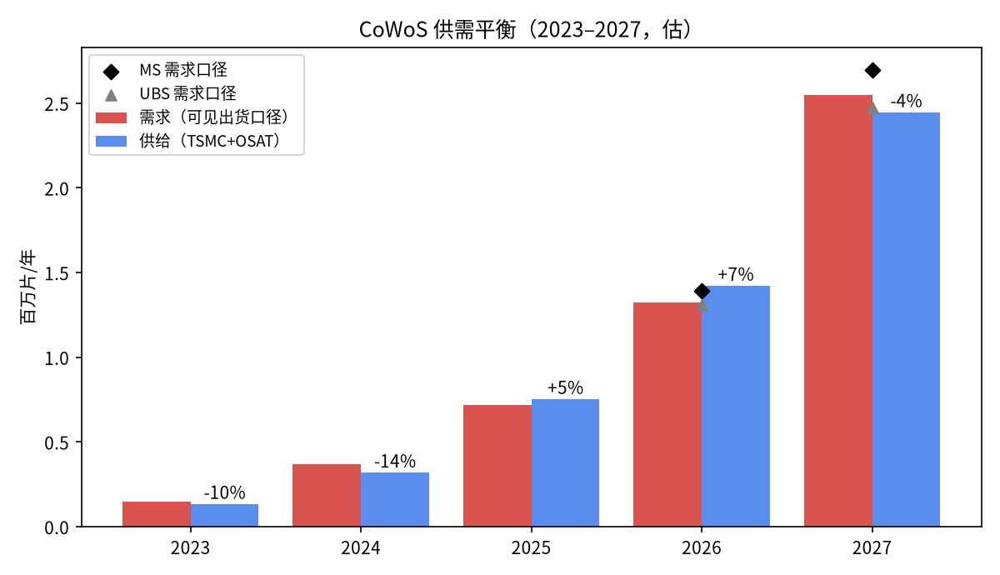
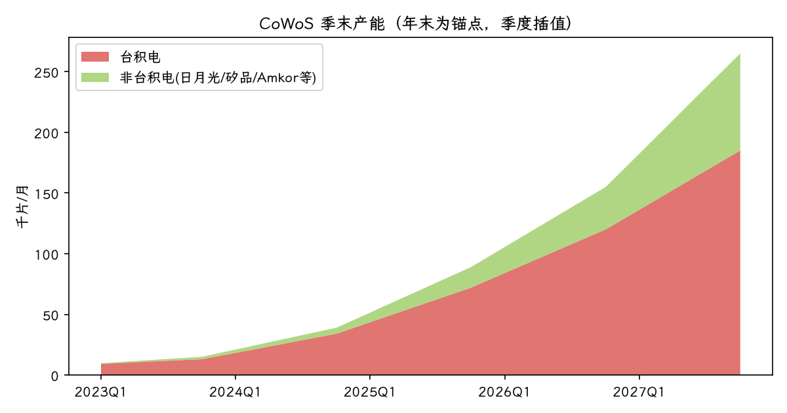
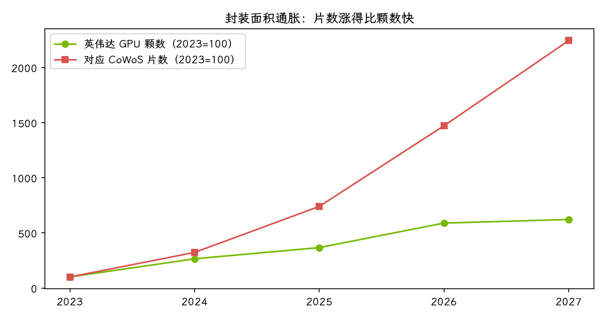

# CoWoS / 先进封装产业链研究 v0.3

> v0.3.1（2026-10-15）：跟随 HBM 页 v0.5——长鑫产能移到 HBM 页的中国账本，不再计入全球 HBM 供给，2027 年 HBM 满足率约 93% → 90%；CoWoS 结论不变。

> v0.3（2026-10-15）：跟随 HBM 页 v0.4 改判。HBM 供给上修约五成后，2027 年 HBM 够出货所需约 93%（上一版约 61%），CoWoS 约 96%（同一口径：KGI 可见出货），两者都只略紧；约束模型里 2027 年最紧的是 ABF 载板（估）。核心判断由"卡住的是 HBM 和基板"改为 **"2027 年卡住 AI 芯片的，不再是 CoWoS，而是载板和 HBM"**。对账改为同一口径；构建合并为 `cowos/build.py`（全站 `./build.sh`）。下文 v0.2 正文中"HBM 只够约六成""HBM 页供给 4.0 EB"等数字已被取代。

> **结论层（与网页同一模板，v0.3 · 版式）**
> - 中心思想：2027 年 CoWoS 只略紧、不再是头号瓶颈，最紧的是载板；利润往载板迁移，设备景气还没见顶。
> - ① 量：2027 年 CoWoS 总量只缺约 4%（客户需求口径约 11%），和 HBM（够约 90%）差不多紧；换成同一单位后，最紧的是 ABF 载板（估）。
> - ② 利润：钱堆在台积电，但利润涨得最快的是扩得慢的载板：欣兴毛利率一年从 13.1% 升到 24.8%【源32】。
> - ③ 时点：设备三家营收同比 +43% 仍在加速、合约负债重回增长；按回测，设备见顶后中位约 4 个月台积电营收同比才见顶。

> Kiko 产业笔记 · 2026-10-15 · 网页版（可拖动假设）：https://johnpeng-cn.github.io/chain-site/cowos.html
> 标注：【源N】= 文末第 N 条公开来源；【估】= 自估。模型代码 `cowos/model.py` + `cowos/build.py`，表格 `cowos/cowos_model.xlsx`。按《小链研究 SOP v1.1》(../SOP.md) 完成（含要害变量、关键玩家与博弈、反方证据）。

## 0 核心判断

**2027 年 CoWoS 只略紧、不再是头号瓶颈，最紧的是载板；利润往载板迁移，设备景气还没见顶。**（v0.3 改写；v0.2 原句为"不再是 CoWoS，而是 HBM 和基板"，HBM 部分已被 HBM 页 v0.4 推翻。）

- CoWoS 产能：台积电年末 1.3 万（2023）→ 3.4 万 → 7.2 万 → 12 万（2026）→ 18.5–19 万片/月（2027）；加上日月光、Amkor 等，2.5D 总产能年末 15 万 → 26.5 万片/月【源1】。
- 自下而上的需求（KGI 出货 × 每片可封颗数）2027 年约 255 万片，供给约 245 万片，**缺口约 4%**（客户需求口径约 11%）【估】。
- 和 HBM 小链对账：2027 年按出货需要 HBM 约 6.5 EB，HBM 页的供给模型约 4.0 EB，**只够约六成**；KGI 也写 HBM 供给只 +45–50%、ABF 只 +25–30%，而 CoWoS +71%【源1】。

三个可证伪的争议：

| # | 问题 | 观点 | 什么情况算我错 |
|---|---|---|---|
| Q1 | 2027 年 CoWoS 还是头号瓶颈吗？ | 不是，缺口 4–11%；HBM、ABF/T-glass 更紧 | 2027 年 HBM 或基板出现库存积压，而 CoWoS 仍排不进 |
| Q2 | OSAT 和 EMIB-T 会分走台积电的利润吗？ | 分走的是溢出量，不是利润中心 | 2027 年 OSAT 2.5D 片数超过台积电三分之一，或台积电先进封装毛利率明显下滑 |
| Q3 | 面积通胀会持续吗？ | 会：每片颗数 H100 约 28 → Rubin Ultra 约 6 | 英伟达改走多封装小芯片、或面板级（CoPoS）2027 年大规模量产 |

## 0′ 要害变量（龙卷风）

每次只动一个假设，看 2027 年结论怎么变（模型同 `model.py`）【估】：

| 变量（低端 / 高端） | 2027 缺口（基准 −3.9%） | CoWoS 满足率 − HBM 满足率（基准 +29pp） |
|---|---|---|
| 每片可封颗数 −20% / +20% | −22.2% / +13.9% | +11.5 / +45.3pp |
| 加速器出货 −20% / +20% | +20.1% / −19.9% | +35.7 / +23.8pp |
| 台积电年末产能 155k（JPM）/ 200k（MS） | −11.2% / −0.3% | +21.8 / +32.0pp |
| 每封装 HBM 容量 −30% / +10% | 不变 | +2.5pp / 更大 |
| HBM 可供量 ×0.8 / ×1.25（TrendForce 口径） | 不变 | 更大 / +13.4pp |

结论：**缺口最怕"每片可封颗数"和"出货"；"短板是 HBM"最怕"每封装 HBM 容量"和"HBM 可供量"。** 单独动哪一个都翻不过来；降规格 30% 和 HBM 上修 25% 同时发生，短板才换成 CoWoS。这两个变量是下一版研究要盯死的。

## 1 边界与工艺

计量单位：12 寸 CoWoS 晶圆（片/月、片/年）。**一片晶圆能封几颗芯片（ppw）是整条链的第一性原理。**

| 方案 | 结构 | 典型产品 | 现状 |
|---|---|---|---|
| CoWoS-S | 整片硅中介层 + TSV，≤约 3.3× 光罩 | H100/H200、MI300/355、TPU | 成熟主力；KGI 称 2027 年 S 型仍紧【源1,10】 |
| CoWoS-L | 有机 RDL + 局部硅桥（LSI），2026 年 5.5×、2027 年 9× 光罩 | B200/B300、Rubin、Rubin Ultra | 英伟达主力；大尺寸翘曲待解决【源10,11,13】 |
| CoWoS-R | 有机 RDL 中介层 | 网通 ASIC、Vera CPU | KGI：R 型被 Vera CPU 占满【源1】 |
| SoIC | 芯片与芯片混合键合（3D） | MI300、未来 Rubin 系列 | Besi 混合键合受益【源20】 |
| InFO / FOPLP / CoPoS | 扇出 / 面板级 | 苹果 A 系列；CoPoS 试产线 2026 年完成 | 2027 年前对 AI 加速器影响有限【源26】 |
| OSAT 类 CoWoS（日月光/矽品、Amkor） | oS 后段 + 自有 2.5D 全流程 | 溢出订单、ASIC | 日月光 LEAP 2026 年 >35 亿美元【源16】 |
| Intel EMIB / EMIB-T / Foveros | 嵌入式硅桥，不需整片中介层 | Intel 自家；谷歌等洽谈中 | 基板良率约 45%，外部量产未见【源21,22】 |

工序：① 中介层制造（台积电自制；S 型约 1 万、L 型约 1.5 万美元/片【源9】）→ ② CoW 上片（均华 Sorter；TCB：ASMPT、韩美）→ ③ 底填与模封 → ④ 湿制程/清洗（弘塑、辛耘）→ ⑤ oS 上基板（ABF 载板）→ ⑥ 检测（万润 AOI、点胶）→ ⑦ 最终测试（京元电、中华精测等）【源28】。

## 2 供需平衡（核心模型）

**需求** = Σ（加速器出货 ÷ 每片良品颗数）+ 其他（交换芯片、FPGA 等）【估】。出货来自 KGI 2026-09-15 Fig.10【源1】。
**供给** = 12 个月的（台积电 + 非台积电）月产能 × 有效稼动率；年内按年末锚点线性插值：全年 = 12a + 6.5(b−a)【估】。2026–27 年有效稼动率 95%【估】。

| 年 | 需求（千片） | 供给（千片） | 供给−需求 | 隐含 HBM 需求 |
|---|---|---|---|---|
| 2023 | 149 | 134 | −9.8% | 0.21 EB |
| 2024 | 370 | 319 | −13.8% | 0.74 EB |
| 2025 | 718 | 753 | +5.0% | 2.03 EB |
| 2026 | 1,324 | 1,422 | +7.4% | 3.84 EB |
| 2027 | 2,546 | 2,446 | −3.9% | 6.55 EB |
| 2027 客户需求口径 | 2,736 | 2,446 | −10.6% | — |

客户需求口径只加了 KGI 点名的三项差额（博通 50 万 vs 排进 38–39 万片、Trainium3、Venice），约 19 万片【源1】【估】。

**交叉验证：**
- 摩根士丹利需求 1.394M / 2.694M 片（2026/2027）【源4】，UBS 1.307M / 2.475M【源2】；本模型 1.324M / 2.546M 落在两者之间。
- 英伟达 2027 年：本模型 1,218k 片，摩根士丹利 1,222k，404K 汇总 1,196–1,222k【源8】。
- 2023–24 年模型缺口 −10%/−14%，与当年 H100 缺货吻合。2025–26 年模型略有富余（+5%/+7%），和"全年紧缺"的说法不一致，原因见局限；模型误差约 ±10%。

### 需求的上一层：云厂商资本开支与 AI 回报

| 项目 | 数据 | 来源 |
|---|---|---|
| 2026 年资本开支指引（四大云厂商） | 约 7,200–7,450 亿美元：亚马逊约 2,200、谷歌 1,950–2,050、微软约 1,750、Meta 1,300–1,450；年内每家都上调或维持 | 【源37】 |
| AI 回报：云业务 Q2 2026 | AWS 营收 422 亿美元 +37%、营业利润 166 亿；谷歌云 248 亿 +82%、营业利润 88 亿（利润率 35.6%）；微软智能云 393 亿 +32% | 【源38,39】 |
| 积压订单（已签未确认） | 三家合计约 1.69 万亿美元；亚马逊 Q1、Q2 各有约 1,000 亿来自 OpenAI、Anthropic | 【源39】 |
| 反方：AWS 资产回报在下降 | AWS 过去 12 个月营业利润 ÷ 期末固定资产 = 21%，一年前 30%；新增固定资产已等于营收的 101% | 【源39】 |
| 英伟达数据中心营收 | Q2 FY27 890 亿美元，同比 +117%；Q3 指引总营收 1,080 亿美元 | 【源36】 |
| 亚马逊：算力仍不够 | Jassy：即使 2,200 亿美元，2026 年仍不够满足需求，2027 年也会如此（Reuters 搜索摘要） | 【源40】 |

亚马逊+微软+谷歌季度资本开支：2023Q2 约 273 亿美元 → 2026Q2 约 1,349 亿美元；积压订单合计约 1.69 万亿美元【源39】。链条：云收入/积压订单 → 资本开支 → 加速器订单 → CoWoS 片数。

各家对台积电年末产能（千片/月）：

| 机构 | 日期 | 2026 | 2027 | 备注 |
|---|---|---|---|---|
| KGI | 2026-09-15 | 120 | 185–190 | 非台积电 35 → 80；台积电对客户需求仍缺 15–20%【源1】 |
| 摩根士丹利 | 2026-09-13 | 130 | 200 | 2028 年 260【源3】 |
| UBS | 2026-09-22 | 行业 160 | 180 | 行业 270：日月光 70、Amkor 20【源2】 |
| 摩根大通 | — | 115 | 155 | 2028 年 175【源6】 |
| Digitimes | 2026-07-10 | — | ≥200 | 付费墙，只看标题【源7】 |

**封装面积通胀：** 英伟达 GPU 颗数 2023→2027 从 1.45M 涨到 9.0M（约 6 倍），消耗的 CoWoS 片数从约 48k 涨到约 1,084k（约 23 倍）。每片颗数 H100 约 28、B200 约 16【源9】、Rubin 约 9–10、Rubin Ultra 约 6【估】。**"CoWoS +70%" 不等于 "GPU +70%"。**

## 3 利润池

各公司都不单独披露 CoWoS 数字，下面是最接近的口径（年化营收 × 毛利率）：

| 环节 | 年化营收（十亿美元） | 毛利率 | 口径 |
|---|---|---|---|
| 台积电先进封装 | 约 21 | 约 60%【估】 | 2026 营收约 1,700 亿美元 × "低双位数"（取 12.5%）【源14】；毛利率"接近公司平均"【源15】 |
| 测试（京元电） | — | 39.5% | 公司整体【源32】 |
| 设备（弘塑等） | — | 约 45% | 公司整体【源32】 |
| 日月光 LEAP | 3.5+ | ATM 27.3% | LEAP 0.6（2024）→ 1.6（2025）→ >3.5（2026 指引）【源16,17】 |
| 载板（欣兴） | 约 5.4 | 24.8% | 2Q26 单季年化，公司整体【源32】 |
| Amkor 先进产品 | — | 16.8% | 公司整体【源18】 |

**利润迁移：** 欣兴毛利率 2Q25 13.1% → 2Q26 24.8%，一年接近翻倍；日月光 17.0% → 21.0%；台积电 58.6% → 67.7%【源32】。利润正在往扩得慢的环节（载板）迁移。

## 4 瓶颈：约束理论（TOC）推导

统一单位：百万颗 AI 加速器封装/季。每一环原始产能 × 单耗系数换算后，每季取最小值；最小值仍高于需求时，约束在市场需求【估】。

| 环节 | 原始单位与来源 | 换算 |
|---|---|---|
| CoWoS 封装 | 千片/月（台积电 + 非台积电）【源1】 | × 3 个月 × 稼动率 − 交换芯片等其他用量，再 × 每片可封颗数（产品加权：2025 年 17.7、2026 年 16.0、2027 年 15.2 颗）【估】 |
| HBM（DRAM 晶圆） | HBM 投片 千片/月，分厂季度 【源33】 | × 3 × 每片有效 GB（600/650/600）× 稼动率 = GB，÷ 每封装 HBM（产品加权：2025 年 174、2026 年 194、2027 年 180 GB）【估】 |
| TC 键合机 | 台数：2024 年底起点约 300 台（估），每季新增 = 韩美月产能（2024 年 22 台 【源42】、2025 年 35、2026 年起 45 台 【源41】）× 3 × 80% ÷ 韩美约 70% 份额（估）；海力士 2025 年一家就采购约 80 台、每条线 2 台 【源43】 | 台数 × 每台每季堆叠数 × 每堆叠 GB（24/28/34/36）÷ 每封装 GB。每台产出（UPH）不公开，用"2024–25 年键合机没有卡住 HBM、至少多 10%"校准（HBM 页结论）【估】 |
| ABF 载板 | AI 封装用载板，无公开分项产能 | 1 颗封装 = 1 片载板。2024–26 年按已发生或已排定的出货 ×1.10/1.05/1.03 反推（2026 年已偏紧 【源23,24】）；2027 年 = 2026 年 × 1.275（KGI：ABF +25–30%）【源1】 【估】 |
| 数据中心电力 | 北美新增吸纳 GW/季：2025H1 约 12.5、2026H1 约 25 GW 【源37】；2024 年、2026H2、2027 年为估（2027 年 14 GW/季） | × AI 占比 60%（估）÷ 每颗 GPU 约 2.83 kW（英伟达：4.25 GW ≈ 150 万颗 GPU）【源36】 ÷ GPU 等效系数（ASIC 0.5、CPU 0.1，估）；规模系数用"2024–25 年没卡住、至少多 10%"校准 【估】 |

数据缺口：HBM4 base die：由台积电等逻辑工艺代工，产能没有公开数据，暂按不受限处理（数据缺口）。 测试：台积电 2Q26 法说会称测试机短缺 【源13】，但京元电等测试产能没有公开数，未画进图（数据缺口）。 前道逻辑晶圆（N4/N3）：没有可拆到 AI 加速器的公开产能，未建模（数据缺口）。

逐季结果（隔季列出，加粗 = 约束）：

| 季度 | 需求 | CoWoS | HBM | 键合机 | 载板 | 电力 | 约束 |
|---|---|---|---|---|---|---|---|
| 2024Q2 | 2.09 | **1.78** | 1.79 | 3.16 | 2.30 | 2.52 | CoWoS |
| 2024Q4 | 2.44 | 2.66 | 3.58 | 4.43 | 2.68 | 2.77 | 需求（各环节都够） |
| 2025Q2 | 2.79 | 2.96 | **2.74** | 3.43 | 2.93 | 3.07 | HBM |
| 2025Q4 | 3.26 | 4.22 | **3.03** | 4.58 | 3.42 | 3.93 | HBM |
| 2026Q2 | 4.74 | 5.21 | **3.73** | 6.41 | 4.89 | 6.75 | HBM |
| 2026Q4 | 5.54 | 6.72 | **4.34** | 8.01 | 5.70 | 7.03 | HBM |
| 2027Q2 | 8.76 | 8.54 | **5.12** | 11.00 | 6.23 | 10.13 | HBM |
| 2027Q4 | 10.22 | 10.93 | **5.91** | 12.83 | 7.27 | 10.13 | HBM |

HBM ×1.25（TrendForce 口径）时：2027Q1 载板 5.71；2027Q2 载板 6.23；2027Q3 载板 6.75；2027Q4 载板 7.27

**约束迁移（模型）**：CoWoS（2024Q1–Q3、2025Q1；2024Q4 各环节都够）→ HBM（2025Q2–2027Q4）；HBM 若按 TrendForce 口径上修 25%，2027 年全年换成 ABF 载板；电力相对需求的余量从 2026 年约 +30%～+55% 降到 2027Q4 约 −1%，2028 年可能轮到电力。

缓冲：

- 约束前的产能缓冲：英伟达供应与产能承诺 2,790 亿美元（一季前 1,190 亿），主要是存储 【源36】（保护约束：提前锁住 HBM）
- 成品缓冲：英伟达库存 258 → 316 亿美元，为 Vera Rubin 备货 【源36】（新架构切换期的出货保护）
- 打破约束的订单缓冲：CoWoS 设备三家合约负债 185.5 亿新台币，约 2.6 个季度营收 【源29,32】（扩产订单已排队，交期 10–12 个月）
- 电力缓冲：北美在建 66 GW、95% 已预租，空置率约 1% 【源37】（下一个约束的缓冲已经很薄）

TOC 五步：

| 步骤 | 含义 | 这条链现在 | 盯什么 |
|---|---|---|---|
| ① 识别 | 把每一环产能换成"百万颗封装/季"，取最小值 | 模型：2024Q1–Q3 和 2025Q1 是 CoWoS（2024Q4 各环节都够），2025Q2 起换成 HBM。行为证据：英伟达下调 HBM 规格以多出货 【源1】；供应承诺一季加到 2,790 亿美元、主要是存储 【源36】 | HBM 页滑块调高后，图上约束是否切换 |
| ② 挖尽 | 不扩产先榨干约束：良率、稼动率、单耗 | HBM：HBM4 良率和每片有效 GB 【源33】；英伟达降每封装容量（单耗下降）【源1】。CoWoS 时代：Rubin 每片 9 → 10 颗（良率改善，估） | 每片有效 GB、每封装 GB 的变化 |
| ③ 迁就 | 非约束环节按约束的节奏排产，不囤非约束产能 | 台积电扩产跟着客户确定订单、溢出给日月光和 Amkor 【源1】；英伟达先锁存储再排其他 【源36】 | CoWoS 稼动率（若 HBM 是约束，CoWoS 应出现余量） |
| ④ 打破 | 扩产 + 交期：约束多久能解除 | DRAM 新厂/洁净室 2–3 年 【源33】；CoWoS 设备交期 10–12 个月 【源27】；T-glass 扩产 2027 年才放量 【源23,24】；电力：PJM 2028/29 容量拍卖按上限出清仍缺 6,831 MW 【源37】 | 原厂资本开支、设备交期、拍卖结果 |
| ⑤ 防惰性 / 迁移 | 约束解除后会移到下一环：提前写下时间和地点 | HBM 按 TrendForce 口径上修 25% 时，2027 年约束转到 ABF 载板；电力相对需求的余量从 2026 年约 +30%～+55% 降到 2027Q4 约 −1%，2028 年可能轮到电力 【估】 | 见下方迁移预测 T1–T3 |

约束迁移预测（到期打分）：

| # | 预测 | 到期 | 验证 |
|---|---|---|---|
| T1 | 约束已从 CoWoS 迁到 HBM：2027-10-31 前，至少一家 HBM 原厂在财报会称 2027 年 HBM 已售罄，同时台积电不再把 CoWoS 产能列为限制客户的首要因素 | 2027-10-31 | 海力士/美光/三星财报会；台积电法说会 |
| T2 | 2027 年下半年约束向 ABF 载板迁移：2027 年内味之素、日东纺或欣兴再次提价，且欣兴任一季毛利率 ≥ 26%（2Q26 为 24.8%） | 2027-12-31 | 公司公告 / MOPS 季报 |
| T3 | 2028 年起电力接棒成为约束：到 2027 年底北美数据中心空置率仍 ≤ 2%，且 PJM 下一次容量拍卖仍按价格上限出清 | 2027-12-31 | JLL/CBRE 半年报；PJM 拍卖结果 |

| 判断 | 反方证据 | 证伪条件 | 指标 · 阈值 | 当前 |
|---|---|---|---|---|
| T1 约束在 HBM | HBM 页供给可能偏保守约 30%（CoWoS 反推 3.8 EB 对 TrendForce 3.75 EB） | 2027 年台积电仍称 CoWoS 是首要限制，或 HBM 原厂有库存 | 法说会措辞；HBM 合约价 · HBM 2027 年混合均价同比 < +30% | TrendForce 预测 +121% |
| T2 下一站是载板 | 载板没有公开的 AI 专用产能，2027 年 +25–30% 只是 KGI 一家口径 【源1】 | 载板价格松动 | 欣兴毛利率；ABF/T-glass 报价 · 欣兴毛利率连续两季 < 20% | 24.8% |
| T3 再下一站是电力 | 电力模型最粗：吸纳量 ≠ 通电量，海外和自建电厂没算进来 | 北美空置率回升 | JLL/CBRE 空置率；PJM 拍卖 · 空置率 > 5%，或拍卖低于价格上限 | 空置率约 1%，PJM 按上限出清 【源37】 |

### 汇总排序（2027 年紧迫度）

| # | 瓶颈 | 现状 | 来源 |
|---|---|---|---|
| 1 | HBM（跨链） | 2027 年按出货需 HBM 约 6.5 EB，HBM 页供给约 4.0 EB；KGI：HBM +45–50% vs CoWoS +71% | 源1,33 |
| 2 | ABF 载板 / T-glass | 日东纺约占 T-glass 90%，扩产 2027 年才放量；载板短缺看到 2028；味之素 ABF 提价 30%；ABF 2027 年只 +25–30% | 源23,24,25,1 |
| 3 | 封装设备交付 | 弘塑交期 10–12 个月，2026 年出机 220–240 台、2027 年约 325 台，只够需求的 1/3–1/4 | 源27 |
| 4 | 测试机 | 台积电 2Q26：测试机也短缺 | 源13 |
| 5 | CoWoS-S/R 结构性缺口 | 博通 2027 年 50 万片只能排进 38–39 万；R 型被 Vera CPU 占满 | 源1 |
| 6 | 台积电 CoWoS 总产能 | 对客户需求缺口从 30–35% 收窄到 15–20% | 源1,3 |
| 7 | 超大中介层翘曲（9× 光罩） | 成本、良率待解 | 源11 |

## 4′ 关键玩家与博弈

| 玩家 | 动机 | 现在在做 | 历史上周期里 | 行为改变的信号 |
|---|---|---|---|---|
| 台积电 | 保护先进封装毛利率（已接近公司平均）【源15】，不想重演过剩；但大客户逼着扩产。 | 连续上调 CoWoS 扩产计划：2026 年末 12 万 → 2027 年末 18.5–19 万片/月，2028 年再加 4–5 万；把溢出订单交给日月光、Amkor，自己留 CoWoS-L 大单 【源1】。CoPoS 2028 年起量 【源1】。 | 2023–2026 年每年都比年初计划多扩（KGI 称"continues to revise up"）【源1】；扩产主要跟着英伟达的确定订单走，不做投机性产能。 | 法说会不再说"封装限制客户成长"【源13】，或年末产能目标第一次下调；资本开支中先进封装占比下降。 |
| 英伟达 | 把出货量最大化、锁住稀缺零部件，挤压竞争对手可用的产能。 | 一个季度内把供应与产能承诺从 1,190 亿美元加到 2,790 亿美元，主要是存储 【源36】；为最大化出货下调 HBM 规格、提价 15% 转嫁成本；Vera CPU 60% 给台积电和日月光、其余给 Amkor（多家供应）【源1】。 | 2023–24 年 CoWoS 紧缺时包下台积电大部分产能，并把 oS 后段外包给 OSAT（行业共识，未单独核实）；库存在新架构前上升（Q2 FY27 库存 258 → 316 亿美元，为 Vera Rubin 备货）【源36】。 | 供应承诺环比下降或出现取消；库存天数持续上升而营收增速放缓；继续下调每封装 HBM 容量（说明 HBM 比 CoWoS 紧）。 |
| 谷歌 / 博通 / 联发科 | 不被单一供应商卡脖子：设计伙伴、封装路线都要有第二来源。 | TPU v9（Humufish）采用 Intel EMIB-T，理由是美国本土化、9 倍光罩大尺寸和台积电产能不足；联发科做 I/O；明显贡献要到 2Q28 【源1】。博通 2027 年要 50 万片 CoWoS，只能排进 38–39 万 【源1】。 | TPU 长期只给博通设计；2026 年起对外部客户（Anthropic）出售或租赁 TPU 【源1】。 | EMIB-T 良率（基板良率约 45%，供应商目标 1Q27 到 60%）【源21】；谷歌是否把第二代产品也放到 EMIB。 |
| 日月光 / Amkor | 从"做 oS 后段"升级成"全流程 CoWoS 第二来源"，拿溢出订单和 CPU 订单。 | 日月光全流程 CoWoS 2 万 → 4.5 万片/月（+125%），拿到约一半 Vera CPU 和大部分 Venice CPU；Amkor 1.5 万 → 2.5 万片/月 【源1】。LEAP 营收 2026 年超过 35 亿美元 【源16】。 | 2023–24 年承接台积电外包的 oS 后段；扩产比台积电保守，靠客户确定订单。 | 日月光资本开支指引下调，或 LEAP 增速明显低于 CoWoS 总产能增速。 |
| Intel | 用 EMIB/Foveros 把代工业务带起来，吃美国本土化需求。 | 为了让基板供应商优先配合，Intel 甚至"必须预付款"【源21】。 | EMIB 2017–18 年就量产，但一直以自家产品为主（公认史实）。 | 出现月产万颗以上的外部 AI 加速器订单（见预测 C6）。 |
| 设备与材料商（弘塑、日东纺、味之素等） | 扩得慢、延长交期、提价，而不是追着需求大扩产。 | 弘塑交期 10–12 个月、订单排到 2030 年 【源27】；味之素 ABF 提价 30% 【源25】；日东纺 T-glass 扩产 2027 年才放量 【源23】。 | 上一轮周期被伤过：载板三家营收 3 个月同比在 2023-11 跌到 −36%（本站回测，源31），所以这次扩产克制。 | 载板厂/材料商宣布大幅扩产或降价；欣兴毛利率掉头（现在 24.8%）【源32】。 |
| 云厂商（亚马逊、谷歌、微软、Meta） | 抢 AI 算力份额；只要云收入和积压订单还在涨，就不会减资本开支。 | 2026 年资本开支指引合计约 7,200–7,450 亿美元，年内都上调过 【源37】；云业务 Q2 增速 32%–82% 【源38】。 | 2022–23 年云增速放缓时，亚马逊资本开支从季度 166 亿美元降到 115 亿美元（2022Q4 → 2023Q2）【源39】，这是上一次"需求上一层"收缩。 | 任何一家下调资本开支指引；云业务增速连续两季放缓；AWS 资产回报继续下降（已从 30% 降到 21%）【源39】。 |

## 5 历史

- 2011–12：首个 CoWoS 产品，赛灵思 Virtex-7 2000T（28nm）【源19,35】。
- 2016：英伟达 GP100 用 CoWoS + HBM2；InFO 量产（苹果 A10）【源19】。
- 2019–20：中介层做到 2 倍光罩以上，A100 用 CoWoS-S【源19】。
- 2023：ChatGPT 之后 H100 需求爆发，CoWoS 成为头号瓶颈（公认史实）；台积电年末产能约 1.3 万片/月，2024 年末翻倍多到 3.4 万【源1】。
- 2024–25：CoWoS-L 量产（B200），台积电产能 3.4 万 → 7.2 万；日月光、Amkor 承接溢出【源1,16】。
- 2026：瓶颈开始从 CoWoS 转向 HBM、T-glass、设备交期【源1,23,27】。

规律：**每一轮瓶颈被扩产解决时，约束就转到扩得最慢的那一环**（2023 中介层 → 2025 CoWoS-L 良率 → 2026–27 HBM 与基板）。

## 6 领先指标与回测

数据：MOPS 月营收（经 FinMind 开放 API）2012-01 至 2026-09【源31】，季报毛利率与合约负债【源32】。

| 指标 | 回测结论 | 当前读数 |
|---|---|---|
| 设备三家月营收（弘塑 3131 + 辛耘 3583 + 万润 6187），3 个月滚动同比 | 和台积电营收同比的水平相关弱：最佳滞后 +3 个月，r=0.36；**同比拐点** 13 次中 11 次领先台积电，提前 1–13 个月，中位 4 个月 | 2026-09 同比 +43%，仍在加速 |
| 载板三家（欣兴 3037、南电 8046、景硕 3189） | 和台积电同步（滞后 0–1 个月，r=0.55），不是领先指标 | — |
| 设备三家合约负债（预收款） | 同比在 1Q23 见顶（+89%），营收同比 3Q24 见顶，领先约 6 个季度；**只有 1 个周期、33 个季度样本** | 2Q26 合计 185.5 亿新台币，同比 +10%，约等于 2.6 个季度营收【源29,32】 |
| Disco 季度出货额 | 未回测 | 2026 年 7–9 月 1,239 亿日元，同比 +60%，创新高【源30】 |

这里有一个和 HBM 一样的教训：设备营收是在验收时确认的，更接近"产能已经装进去"，水平上是同步而不是领先；真正有领先意义的是拐点、合约负债和设备商的订单/出货。

## 7 预测台账（到期打分，不改原文）

| # | 预测 | 到期 | 验证来源 |
|---|---|---|---|
| C1 | 台积电 2026 全年先进封装营收占比 ≥ 12% | 2027-01-21 | 台积电 4Q26 法说会 |
| C2 | 设备三家 2026 年 10–12 月营收合计同比 ≥ +30%（7–9 月为 +43%） | 2027-01-12 | MOPS 月营收 |
| C3 | 日月光 2026 全年 LEAP 营收 ≥ 37 亿美元 | 2027-02-28 | 日月光 4Q26 法说会 |
| C4 | 设备三家 4Q26 合约负债合计同比 ≥ +15% | 2027-03-31 | 三家 2026 年报 |
| C5 | Rubin Ultra 正式规格每封装 HBM ≤ 384GB（原路线图约 1TB），说明 HBM 比 CoWoS 更紧 | 2027-06-30 | GTC 2027 / 官方规格 |
| C6 | 2027 年内 Intel EMIB-T 没有外部 AI 加速器客户进入月产万颗以上量产 | 2027-12-31 | Intel/谷歌公告 |
| C7 | 台积电 2027 年末 CoWoS 产能 ≥ 18 万片/月 | 2028-01-31 | 台积电法说会 / 主流券商 |
| C8 | 四大云厂商（亚马逊、谷歌、微软、Meta）首次给出的 2027 年资本开支指引合计 ≥ 8,500 亿美元（2026 年中值约 7,325 亿，+16%） | 2027-02-15 | 各公司 4Q26 财报电话会 |

### 反方证据与证伪条件

| 判断 | 已看到的反方证据 | 证伪条件 | 指标 · 阈值 | 当前读数 |
|---|---|---|---|---|
| J1 2027 年 CoWoS 不再是头号瓶颈 | KGI 仍估台积电对"客户需求"缺口 15–20%，S/R 型都缺 【源1】；2025–26 年本模型显示总量富余，但市场普遍说紧，说明模型可能低估了需求。 | 2027 年 CoWoS 订单仍大量排不进，同时 HBM 和基板没有出现缺货迹象。 | 券商对台积电 2027 年 CoWoS 缺口的口径；台积电法说会措辞 · 2027 年中缺口口径 ≥ 25%，或台积电 2027 年末产能 < 16 万片/月 | 15–20%（KGI）；年末 18.5–19 万 【源1】 |
| J2 2027 年 HBM 是木桶短板 | 本页按出货反推的 2026 年 HBM 需求（3.8 EB）和 TrendForce 预测的 HBM 出货一致 【源34】，比 HBM 页供给高 30%，说明 HBM 供给可能被低估。 | 2027 年 HBM 合约价涨幅很小，或英伟达不降规格。 | 2027 年 HBM 混合均价；Rubin Ultra 每封装 HBM 容量 · 均价同比 < +30%，或 Rubin Ultra ≥ 512GB | TrendForce 预测 2027 年混合均价 +121%（HBM 页源36）；KGI 称英伟达在下调 HBM 规格 【源1】 |
| J3 利润往载板迁移 | 欣兴毛利率含非 ABF 业务；毛利率跳升可能部分来自一次性因素。 | 载板毛利率回落，而台积电/OSAT 毛利率继续上升。 | 欣兴（3037）季度毛利率 · 连续两季 < 20% | 2Q26 24.8%（一年前 13.1%）【源32】 |
| J4 需求上一层（云厂商资本开支）继续上修 | AWS 资产回报已从 30% 降到 21%，新增固定资产等于营收的 101% 【源39】；资本开支增长有一部分是存储涨价，不是更多算力 【源37】。 | 云厂商 2027 年资本开支指引持平或下降。 | 四大云厂商 2027 年首次资本开支指引（2027 年 1–2 月财报） · 合计同比 < +10%，或任一家下降 | 2026 年约 7,325 亿美元（中值）；谷歌、微软都说 2027 年继续增长 【源37】 |
| J5 封装周期还没见顶 | 设备三家营收同比已到 +43%，历史上这个位置之后几个月常见顶。 | 设备三家营收同比见顶回落。 | 弘塑+辛耘+万润 3 个月营收同比（每月 10 日 MOPS） · 从峰值回落 ≥ 20 个百分点并连续 3 个月下行 → 按回测约 4 个月后台积电营收同比见顶 | 2026-09 +43%，仍在上升 【源31】 |

## 8 公司与资本图谱

| 环节 | 公司（代码） | 看点 |
|---|---|---|
| 代工 | 台积电 2330 | 年末 12 万 → 18.5 万片/月【源1】 |
| OSAT | 日月光投控 3711、Amkor AMKR、力成 6239、长电科技 600584、通富微电 002156 | LEAP 2026 年 >35 亿美元【源16】 |
| 设备 | 弘塑 3131、辛耘 3583、万润 6187、均华 6640、Disco 6146、BESI、ASMPT 0522 | 弘塑交期 10–12 个月【源27】；Disco 出货 +60%【源30】 |
| 载板与材料 | 欣兴 3037、南电 8046、Ibiden 4062、日东纺 3110、味之素 2802、兴森科技、深南电路 | T-glass、ABF 提价【源23,25】 |
| 测试 | 京元电 2449、中华精测 6510、旺矽 6223、Advantest 6857 | 测试机短缺【源13】 |
| 竞争方案 | Intel（EMIB/Foveros） | 基板良率约 45%【源21】 |
| 客户/设计服务 | 英伟达、博通、AMD、谷歌、联发科、AWS、世芯 3661 | 需求方 |

A 股、台股公司的 CoWoS 专项营收占比基本都没披露，表里是业务归属，不是暴露度。

## 9 对外接口（交给大链）

| 输出 | 2026 | 2027 | 说明 |
|---|---|---|---|
| 可供量 | 约 1.42 百万片 | 约 2.45 百万片 | 本页模型【估】 |
| 每片可封颗数 | B300 12–13、Rubin 9 | Rubin 10、Rubin Ultra 6 | 【估】，锚点 H100 28、B200 16【源9】 |
| 每封装 HBM | B300/Rubin 288GB | Rubin Ultra 约 256GB；MI450 432GB；TPU v8i 288GB | 【源1】与公开规格 |
| 出货隐含 HBM 需求 | 3.84 EB | 6.55 EB | 【估】 |
| 价格 | 中介层 S 约 1 万、L 约 1.5 万美元/片 | B200 封装成本 1,000–1,100 美元/颗 | 【源9,10】 |

约束公式：**可出货加速器 = min(CoWoS 片 × 每片颗数, HBM 可供量 ÷ 每封装 HBM, 载板, 前道逻辑晶圆)**。

**与 HBM 小链对账：** 2026 年按出货需要 HBM 约 3.84 EB，和 TrendForce 预测的 2026 年 HBM 出货（超过 300 亿 Gb，约 3.75 EB）【源34】吻合，比 HBM 页供给模型（2.91 EB）高约 30%，所以 HBM 页"每片有效 GB"的假设可能偏保守，下一版要上修。即使上修 25%，2027 年 HBM 也只够约 75%，短板仍是 HBM。

## 局限
- 台积电不单独披露 CoWoS 产能、营收和毛利率。产能用券商口径（KGI 为基准，其他口径并列），季度值是年末锚点之间的线性插值。
- 每片可封颗数（ppw）大多是自估，只有 H100≈28、B200≈16 两个公开锚点；它直接决定需求片数，是本模型最敏感的假设（滑块可调）。
- 出货量用 KGI 的预测（已经考虑了供给限制），所以"可见出货口径"的缺口天然偏小；"客户需求口径"只加了 KGI 点名的三项差额（约 19 万片），不是完整的未受限需求。
- 2025–26 年模型显示总量略有富余（+5%～+7%），与"全年紧缺"的公开说法不完全一致，可能来自：爬坡期良率、S/L/R 型号错配、在制品时滞。误差约 ±10%。
- 利润池里只有台积电先进封装毛利率是估的（"接近公司平均"）；其他公司毛利率是公司整体或业务线口径，不是 CoWoS 专项。
- 多家券商数据来自转述（TechFlow、Longbridge、36Kr、Hilo、KuCoin），原报告未见；Digitimes 2026-07-10 有付费墙只看到标题；Reuters 页面拒绝我的抓取（401），LEAP 2025 年数据来自搜索摘要。
- 回测样本：设备月营收 2014–2026 共 153 个月，但只有约 6 个完整周期；合约负债只有 33 个季度、1 个完整周期。
- 不构成投资建议。

## 来源（2026-10-15 打开核对）

1. KGI 2026-09-15：2027 AI chip outlook（CoWoS 产能、出货、AI 加速器预测） — https://www.kgi.com.hk/en/-/media/files/kgishk/research-reports/tw-reports/semiconductor-sector-_20260915_en.pdf
2. UBS 2026-09-22（TechFlow 转述）：行业 CoWoS 2027 年末 270kwpm — https://www.techflowpost.com/en-US/newsletter/137464
3. 摩根士丹利 2026-09-13（Longbridge 转述）：台积电 130k/200k/260k — https://longbridge.com/en/topics/100000000898184
4. 摩根士丹利 2026-06-23（KuCoin 转述）：全球需求 1.394M→2.694M 片 — https://www.kucoin.com/news/flash/morgan-stanley-report-tsmc-s-2027-ai-revenue-to-double-cowos-capacity-remains-a-bottleneck
5. 36Kr 转述摩根士丹利：分客户 CoWoS 需求 — https://eu.36kr.com/en/p/3892020701149697
6. Hilo 转述摩根大通：115K/155K/175K — https://www.xxquant.com/en/institution/institutional-research/16bdea7eb4987ae838d029976ec407bd
7. Digitimes 2026-07-10：2027 年至少 20 万片（付费墙） — https://www.digitimes.com/news/a20260710PD226/tsmc-cowos-2027-packaging-capacity.html
8. 404K Research 2026-07-10：190–200kwpm 共识、英伟达 1,196–1,222k 片 — https://404kresearch.substack.com/p/tsmc-cowos-capacity-allocation-update
9. 爱建证券 2026-05-12 先进封装设备点评（引 SemiAnalysis：H100 28 颗/片、B200 16 颗/片、中介层价值） — https://pdf.dfcfw.com/pdf/H3_AP202605121822218877_1.pdf?1778609220000.pdf=
10. Silicon Analysts：CoWoS 成本与 S/L/R 对比 — https://siliconanalysts.com/analysis/cowos-packaging-cost-chiplet-vs-monolithic-2026
11. TechNews 2026-04-10：摩根士丹利谈 Rubin Ultra、9× 光罩、EMIB-T — https://technews.tw/2026/04/10/tsmc-rubin-ultra-cowos-l/
12. Hilo：CoWoS-L 与 SoIC 仍是关键变量 — https://www.xxquant.com/en/institution/institutional-research/2365b6ed14516412f14dcd33cbc276c1
13. FinmoConf：台积电 2Q26 法说会纪要（封装限制客户成长、测试机短缺、资本开支） — https://finmoconf.diveinvest.net/en/tsmc/2026-q2
14. AI Prediction Index：魏哲家 4Q25 法说会原话（先进封装 2024 约 8%、2025 略超 10%、2026 低双位数） — https://www.aipredictionindex.com/p/wei-2026-advanced-packaging-low-teens-2026/
15. StockAnalysis：台积电 2Q24 法说会逐字稿（先进封装毛利率接近公司平均） — https://stockanalysis.com/quote/tpe/2330/transcripts/185629-q2-2024/
16. FinmoConf：日月光 2Q26 法说会纪要（LEAP、资本开支、面板线、ATM 毛利率） — https://finmoconf.diveinvest.net/en/ase/2026-q2
17. Reuters 2025-02-13：日月光 2025 LEAP 16 亿美元（页面拒绝抓取，搜索摘要） — https://www.reuters.com/technology/taiwans-ase-sees-2025-advanced-packaging-testing-revenue-more-than-doubling-16-2025-02-13/
18. Amkor 2Q26 财报 — https://ir.amkor.com/news-releases/news-release-details/amkor-technology-reports-financial-results-second-quarter-2026
19. 台积电 CoWoS 技术页（The Chronicle of CoWoS） — https://www.tsmc.com/english/dedicatedFoundry/technology/CoWoS
20. TrendForce 2026-03-18：SoIC 产能、Besi 受益 — https://www.trendforce.com/news/2026/03/18/news-nvidia-rubin-ultra-and-feynman-reportedly-to-boost-tsmc-soic-besi-applied-materials-tel-to-benefit/
21. TrendForce 2026-09-23：Intel EMIB 基板良率约 45% — https://www.trendforce.com/news/2026/09/23/breaking-intel-emib-substrate-yields-reportedly-hit-45-suppliers-eye-60-by-1q27/
22. Tom's Hardware 2026-07-15：EMIB 受青睐、谷歌 TPU v9 — https://www.tomshardware.com/tech-industry/semiconductors/intels-emib-packaging-gains-traction-as-chip-designers-look-to-skirt-tsmcs-cowos-constraints-googles-reported-decision-for-9th-gen-tpus-highlights-intels-attractive-alternative
23. Tom's Hardware 2026-03-09：T-glass 短缺，日东纺约 90% — https://www.tomshardware.com/tech-industry/shortages-of-crucial-chip-packaging-material-threatens-ai-accelerator-supply-chains-nittobos-fukushima-plant-is-tripling-capacity-but-itll-take-years-before-market
24. Digitimes 2026-08-14：T-glass 需求激增，载板短缺看到 2028（标题与摘要） — https://www.digitimes.com/news/a20260814PD224/demand-ic-substrate-2028-fiberglass-cloth-infrastructure.html
25. Wccftech 2026-05-11：味之素 ABF 提价 30%，缺口延续到 2027 — https://wccftech.com/msg-maker-ajinomoto-to-raise-prices-as-abf-substrate-supply-demand-gap-extends-to-2027/
26. 首尔经济 2026-08-11：台积电 CoPoS 产线完成 — https://en.sedaily.com/international/2026/08/11/tsmc-completes-line-for-next-gen-copos-packaging-sees-year
27. 优分析 2026-09-17：弘塑订单看到 2030 年、交期 10–12 个月 — https://uanalyze.com.tw/articles/7953455522
28. 工商时报 2026-04-08：弘塑、万润、均华、辛耘 — https://www.ctee.com.tw/news/20260408700071-439901
29. 理财周刊 2026-08-19：万润、弘塑、辛耘合约负债 — https://www.moneyweekly.com.tw/ArticleData/Info/Article/243680
30. BigGo 2026-10-06：Disco 7–9 月出货创新高 — https://finance.biggo.com/news/7d02eada-b120-4191-92ea-9a9702976288
31. MOPS 月营收（经 FinMind 开放 API 下载：3131/3583/6187/3711/2330/3037/8046/3189 等） — https://api.finmindtrade.com/api/v4/data?dataset=TaiwanStockMonthRevenue&data_id=3131&start_date=2012-01-01
32. MOPS 季报（经 FinMind：毛利率、合约负债） — https://api.finmindtrade.com/api/v4/data?dataset=TaiwanStockFinancialStatements&data_id=2330&start_date=2022-01-01
33. 本站 HBM 小链（供给模型、每封装容量） — https://johnpeng-cn.github.io/chain-site/hbm.html
34. TrendForce 2025-05：2026 年 HBM 出货超过 300 亿 Gb — https://www.trendforce.com/presscenter/news/20250522-12589.html
35. 台积电新闻稿：赛灵思 28nm CoWoS 量产 — https://pr.tsmc.com/english/news/1792
36. NVIDIA CFO Commentary Q2 FY2027（SEC 8-K 附件）：供应与产能承诺 1,190 亿 → 2,790 亿美元，主要为存储；库存 258 → 316 亿美元 — https://www.sec.gov/Archives/edgar/data/1045810/000104581026000073/q2fy27cfocommentary.htm
37. Datacentres.com：四大云厂商 2026 年资本开支指引（7 月财报，引各公司电话会） — https://www.datacentres.com/guides/hyperscaler-capex-trends
38. CRN 2026-07：AWS/微软/谷歌云 Q2 2026 营收、增速、营业利润 — https://www.crn.com/news/cloud/2026/aws-vs-microsoft-vs-google-cloud-earnings-q2-2026-face-off
39. Midgard Finance：云业务季度营收、积压订单（RPO）、资本开支、AWS 资产回报（取自各公司财报） — https://www.midgardfinance.com/research/cloud/
40. Reuters 2026-07-30：亚马逊上调资本开支，Jassy 称 2026、2027 年算力都不够（页面拒绝抓取，搜索摘要） — https://www.reuters.com/business/retail-consumer/amazon-beats-estimates-quarterly-cloud-revenue-growth-2026-07-30/
41. 电子新闻 ETNews 2025-07-30：韩美半导体 TC 键合机月产能 35 台，2026 年扩到 45 台；HBM3E 12 层用 TC 键合机份额 90% 以上 — https://www.etnews.com/20250730000336
42. 亚洲经济 2024-07-05：韩美半导体年产 264 台（月 22 台）TC 键合机 — https://www.asiae.co.kr/en/article/2024070519155971905
43. The Elec 2025-03-14：SK 海力士 2025 年计划采购约 80 台 TC 键合机，每条 HBM 线 2 台 — https://www.thelec.net/news/articleView.html?idxno=5189

## 中国账本（v0.4，2026-10-15）

**中心思想**：中国的 2.5D 封装是和 HBM 并列的第二道墙：台积电这条路已经关死，2026 年国内给国产 AI 卡的 2.5D 刚好够 HBM 能配的卡（约 100%），只够不缺货需求的约 36%；2027 年国内产能翻倍、封装让位给 HBM，下一个卡点是 ABF 膜。

口径：只算国产 AI 卡要用、只能在大陆做的 2.5D 封装。中国账本只算国产 AI 加速卡要用、且只能在中国大陆做的 2.5D 封装（硅中介层 / 有机中介层 / 硅桥）。台积电 CoWoS 2024-11 起不接中国 AI 芯片 [源48]、2025-01 起 16/14nm 以下逻辑芯片须由白名单设计商或封测厂经手 [源44,45]，所以这本账和全球账本不重复。

| 年份 | 国产 AI 可用（千片） | 不缺货需求 | HBM 能配的卡所需 | 2.5D 能封（百万张） | HBM 能配 + 950PR（百万张） |
|---|---|---|---|---|---|
| 2025 | 71 | 72 | 72 | 1.28 | 1.30 |
| 2026 | 128 | 357 | 129 | 1.80 | 1.81 |
| 2027 | 261 | 521 | 140 | 3.13 | 1.68 |

模型：供给 = 年均（年底月产能）× 12 × 给国产 AI 比例 70% × 稼动率 85%；需求 = 要 2.5D 的卡 ÷ 每片颗数（18/14/12）。全部为估，产能锚点来自调研纪要（弱）。

**约束（TOC，2026）**：前道逻辑（中芯 7nm 级 + 台积电 die bank）：不是约束；HBM（HBM 页中国账本）：约束；2.5D 先进封装（本页）：约束（与 HBM 并列）；ABF 膜 / 载板：风险（数据弱）；键合设备（TCB）：暂不是约束

**时间表**：
- 2019–2020-09：初代昇腾 910 由台积电 7nm 代工（计算 die + I/O die + 4 颗 HBM2E 合封）；台积电 2020-09 后停止为华为生产【源50】
- 2023：盛合晶微 2.5D 业务进入规模量产【源51】
- 2024-10：TechInsights 在昇腾 910B 里发现台积电 die；台积电停止给算能（Sophgo）出货【源46】
- 2024-11-11：台积电停止向中国大陆 AI/GPU 客户供应 7nm 及以下芯片【源48】
- 2025-01-15：BIS 代工尽调规则：16/14nm 以下逻辑芯片默认受控，须白名单设计商或白名单封测厂（含台积电、日月光、安靠）经手；算能列入实体清单【源44,45】
- 2025-04：路透：台积电或因算能/华为案被罚 10 亿美元以上；华为经算能拿到近 300 万颗 die【源47】
- 2025-06：华为 910D 专利显示四芯粒 + 硅桥互连（类 CoWoS-L / EMIB）【源60】
- 2025-09：SemiAnalysis：die bank 约 9 个月内用完；中芯产能不再是瓶颈，HBM 是【源49】
- 2026-04-21：盛合晶微科创板上市（688820）【源52】
- 2026-06：普莱信国产 TCB 键合机称批量出货【源59】
- 2026-08：传味之素对华 ABF 减供 30%（未获第三方印证）【源55,56】
- 2026 年底：国内 2.5D 三家合计约 2–2.6 万片/月（纪要，弱）【源53,54】
- 2027 年底：约 5 万片/月（纪要，弱）；2.5D 让位给 HBM 成为唯一约束（本页推导，估）【源53】

**预测**：
- N1（2027-03-31）国内 2.5D（CoWoS 类）三家合计月产能 2026 年底 ≥ 2 万片；验证：盛合 / 通富 / 长电年报或券商统计；< 1.5 万片算错
- N2（2027-04-30）盛合晶微 2026 年芯粒多芯片集成封装收入同比 ≥ +30%；验证：盛合晶微 2026 年年报
- N3（2027-12-31）2027 年底前出现 950DT 或 960 的第三方拆解，没有发现 2025 年后制造的台积电 die；验证：TechInsights 等拆解报告
- N4（2028-04-30）大陆 ABF 膜自给率 2027 年仍 < 15%；验证：华正新材 / 莲花控股年报 + 行业统计
- N5（2027-12-31）2027 年报道里国产卡出货受限的主因仍是 HBM，而不是 2.5D 封装；验证：Reuters / SemiAnalysis / 公司电话会

**证伪**：
- CJ1 2026 年 2.5D 和 HBM 一样紧，2027 年让位给 HBM：证伪条件 2027 年出现“有 HBM 没封装”的报道（长鑫 HBM 积压，国产卡仍出不来）；或 2026 年底国内产能 < 1.5 万片/月。
- CJ2 台积电这条路已经关死：证伪条件 在 2025 年后制造的国产 AI 卡里再次发现台积电 die 或台积电 CoWoS。
- CJ3 ABF 膜是下一个卡点：证伪条件 味之素公开否认减供，且 2027 年国产卡没有因载板交付延迟的报道。

**A 股（证据强度）**：
- 2.5D 封装 · 盛合晶微（688820.SH）：国内 2.5D 份额约 85%（2024），2.5D 服务收入 2024 年 19.6 亿元【强（招股书）】
- 2.5D 封装 · 通富微电（002156.SZ）：纪要称 2026 年 CoWoS 类月产能规划 0.8–1.0 万片；公司未披露【弱（纪要）】
- 2.5D 封装 · 长电科技（600584.SH）：XDFOI 平台；纪要称 2026 年月产能规划 0.5–0.8 万片；公司未披露【弱（纪要）】
- 2.5D 封装 · 华天科技（002185.SZ）：被自媒体列为承接先进封装订单；没有具体数字【弱（自媒体）】
- ABF 载板 · 兴森科技（002436.SZ）：FCBGA 封装基板仍在小批量生产，大批量取决于客户【强（投资者关系记录）】
- ABF 载板 · 深南电路（002916.SZ）：广州 FC-BGA 22 层及以下量产，24 层以上在研发打样【强（年报）】
- ABF 类膜 · 华正新材（603186.SH）：CBF 膜良率 85%+、一期 300 万㎡/年，称已小批量供昇腾【中（媒体）】
- ABF 类膜 · 莲花控股（纽菲斯）（600186.SH）：NBF 膜中低端批量供货，规划约 200 万㎡/年【中（媒体）】
- ABF 类膜 · 宏昌电子（603002.SH）：GBF 膜小批量试产，规划 2026Q4 放量，进入昇腾备选【弱（媒体）】
- ABF 类膜 · 生益科技（600183.SH）：类 ABF 膜送样验证，尚未量产【弱（媒体）】

**新增来源（44–62）**：
- 源44：BIS 2025-01-15 新闻稿：代工尽调规则——16/14nm 以下逻辑芯片默认受控，须白名单设计商或白名单封测厂经手；算能等 16 家列入实体清单 https://www.bis.gov/press-release/commerce-strengthens-restrictions-advanced-computing-semiconductors-enhance-foundry-due-diligence-prevent
- 源45：eCFR 15 CFR 740 补充 7：白名单封测厂（含安靠、日月光、台积电、联电等） https://www.ecfr.gov/current/title-15/subtitle-B/chapter-VII/subchapter-C/part-740/appendix-Supplement%20No.%207%20to%20Part%20740
- 源46：路透 2024-10-26：TechInsights 在华为处理器里发现台积电芯片后，台积电停止给算能出货（页面拒绝抓取，用搜索摘要） https://www.reuters.com/technology/tsmc-suspended-shipments-china-firm-after-chip-found-huawei-processor-sources-2024-10-26/
- 源47：TechCrunch 2025-04-09（转引路透）：台积电或因算能/华为案被罚 10 亿美元以上 https://techcrunch.com/2025/04/09/us-may-fine-tsmc-1b-over-chip-allegedly-used-in-huawei-ai-processor/
- 源48：TechNode 2024-11-11（转引 FT/路透）：台积电 11-11 起停止向中国大陆 AI/GPU 客户供应 7nm 及以下芯片 https://technode.com/2024/11/11/tsmc-halts-supply-of-7nm-and-below-ai-chips-to-mainland-china-report/
- 源49：SemiAnalysis 2025-09-08：Huawei Ascend Production Ramp——die bank 超过 290 万颗、约 9 个月内用完；最多约 2 万片/月中芯产能即可每月出数百万颗 die；HBM 是瓶颈（付费，只看公开部分） https://newsletter.semianalysis.com/p/huawei-ascend-production-ramp
- 源50：Tom's Hardware：初代昇腾 910 由计算 die、I/O die、4 颗 HBM2E 组成，台积电 2019–2020-09 代工 https://www.tomshardware.com/tech-industry/artificial-intelligence/huawei-reportedly-acquired-two-million-ascend-910-ai-chips-from-tsmc-last-year-through-shell-companies
- 源51：华安证券 2025-11 盛合晶微招股书梳理：2024 年中国大陆 2.5D 收入第一、份额约 85%；芯粒多芯片集成封装服务收入 2024 年 19.6 亿元、2025H1 16.9 亿元，主要为 2.5D；部分 TSV 转接板客户供料；募投新增 1.6 万片/月三维多芯片集成 + 4,000 片/月 3D IC https://pdf.dfcfw.com/pdf/H3_AP202511041774848865_1.pdf
- 源52：中国日报 2026-04-21：盛合晶微登陆科创板（688820） https://caijing.chinadaily.com.cn/a/202604/21/WS69e72360a310942cc49a8a42.html
- 源53：君实财经调研纪要（新浪财经 2026-02-09）：2026 年 CoWoS 类月产能规划通富 0.8–1.0 万、盛合 0.6–0.8 万、长电 0.5–0.8 万片，合计 2–2.6 万，2027 年约 5 万；中芯国际未规模量产 CoWoS（纪要，弱） https://finance.sina.com.cn/roll/2026-02-09/doc-inhmfqcf9150021.shtml
- 源54：Alpha股研所（东方财富财富号 2026-09-26）：国内一供 2026-09 月产能 S 级 7,500 + L 级 2,000 片，年底 S 级 1.2 万 + L 级 0.3 万以上；华为系封装厂切入二供（自媒体，弱） https://caifuhao.eastmoney.com/news/20260926202523801496530
- 源55：芯智讯（电子技术应用转载 2026-08-14）：味之素 ABF 全球份额 > 95%，传对华减供 30%（未获第三方印证）；高盛估 ABF 载板缺口 2026H2 10%、2027 年 21%；华正 CBF、纽菲斯 NBF、宏昌 GBF、生益类 ABF 进展 https://www.chinaaet.com/article/3000179741
- 源56：工商时报 2026-08-17：大陆 ABF 自给率不足 5%；华正 CBF 良率 85%+、已向昇腾小批量供货 https://www.ctee.com.tw/news/20260817700068-439901
- 源57：兴森科技 2026-05-08 投资者关系活动记录：FCBGA 封装基板处于小批量生产，大批量取决于需求与客户进度 https://static.cninfo.com.cn/finalpage/2026-05-08/1225285130.PDF
- 源58：深南电路 2025 年年度报告：广州 FC-BGA 22 层及以下量产，24 层以上研发打样 http://static.cninfo.com.cn/finalpage/2026-03-13/1225006759.PDF
- 源59：半导体行业观察 2026-06-10：普莱信 TCB 获先进封装 / CPO 头部客户批量订单，支持 CoWoS、EMIB 的 C2W/C2S（公司宣传稿） http://www.semi-insights.com/s/bdt/15/50375.shtml
- 源60：TrendForce 2025-06-17：华为四芯粒 910D 专利，用硅桥互连而非传统中介层（类 CoWoS-L / EMIB） https://www.trendforce.com/news/2025/06/17/news-huaweis-quad-chiplet-910d-reportedly-takes-shape-with-advanced-packaging-to-challenge-tsmc-nvidia/
- 源61：路透 2026-03-27（RTHK 转载）：华为 2026 年计划出货约 75 万颗 950PR https://news.rthk.hk/rthk/en/component/k2/1849055-20260327.htm
- 源62：本站 HBM 小链 · 中国账本：国产卡能用上的 HBM 与能配的卡数（模型输出，每次构建同步） hbm.html#cn
